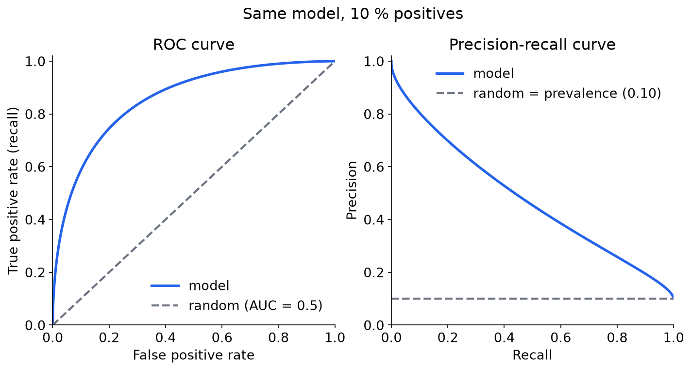
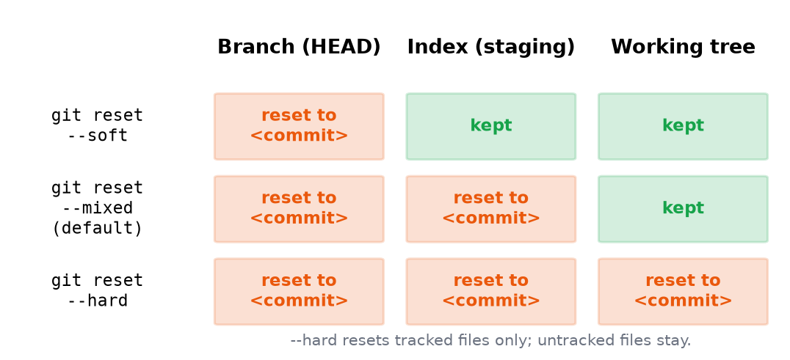
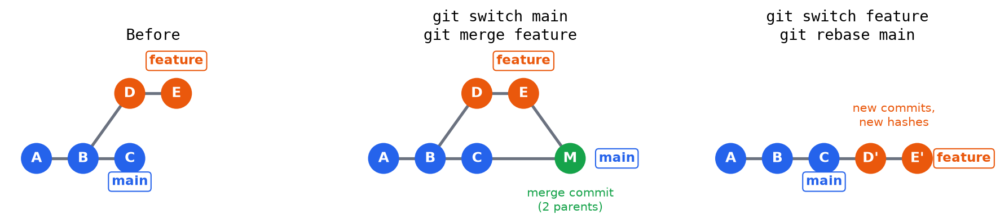
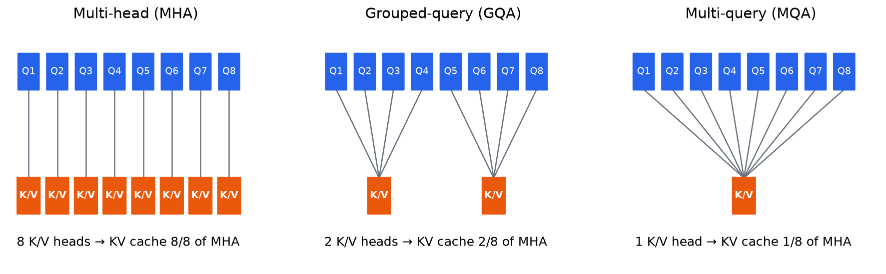
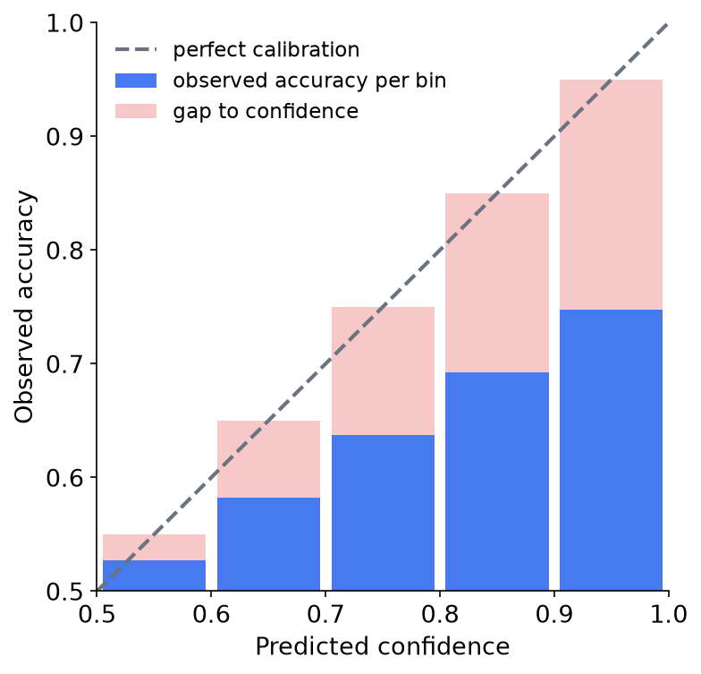

# Flashcards: Visual Pilot

## Image on the Back

- Sketch the ROC and precision-recall curves of a random classifier when 10% of examples are positive. == 
- Which of branch, index, and working tree do git reset --soft, --mixed, and --hard change? == 

## Image Plus Text on the Back

- How does the history differ after merging versus rebasing a feature branch onto main? ==  Merge adds a merge commit with two parents; rebase replays D and E as new commits D' and E' on top of main.
- How do MHA, GQA, and MQA share key/value heads among query heads? ==  MHA gives every query head its own K/V head, GQA shares one K/V head per group, MQA shares a single K/V head; the KV cache shrinks accordingly.

## Image on the Front

-  Is this model overconfident or underconfident? == Overconfident: in every bin the observed accuracy is below the predicted confidence, so the bars sit under the diagonal.

## Format Tests

- (Multi-line variant) Sketch the ROC and precision-recall curves of a random classifier when 10% of examples are positive. >>>
    - 
- (LaTeX test, single dollar) What is the KL divergence of Q from P? == $D_{KL}(P \parallel Q) = \sum_x P(x) \log \frac{P(x)}{Q(x)}$
- (LaTeX test, double dollar) What is the KL divergence of Q from P? == $$D_{KL}(P \parallel Q) = \sum_x P(x) \log \frac{P(x)}{Q(x)}$$
